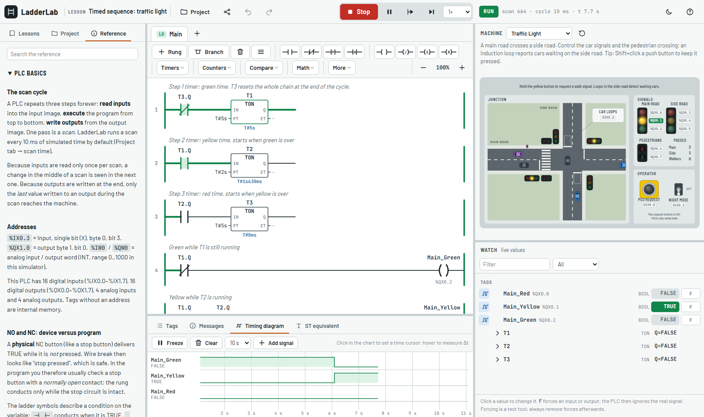
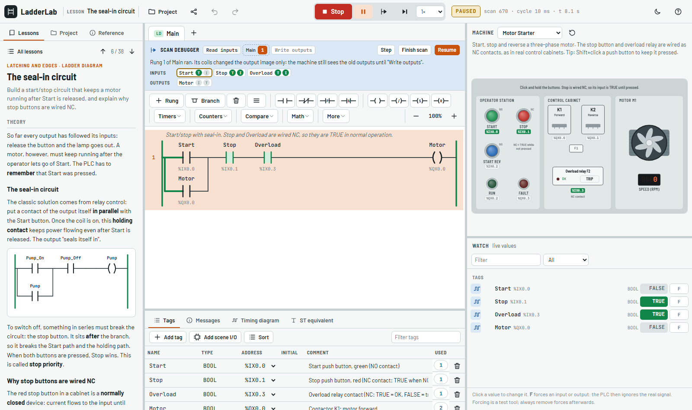
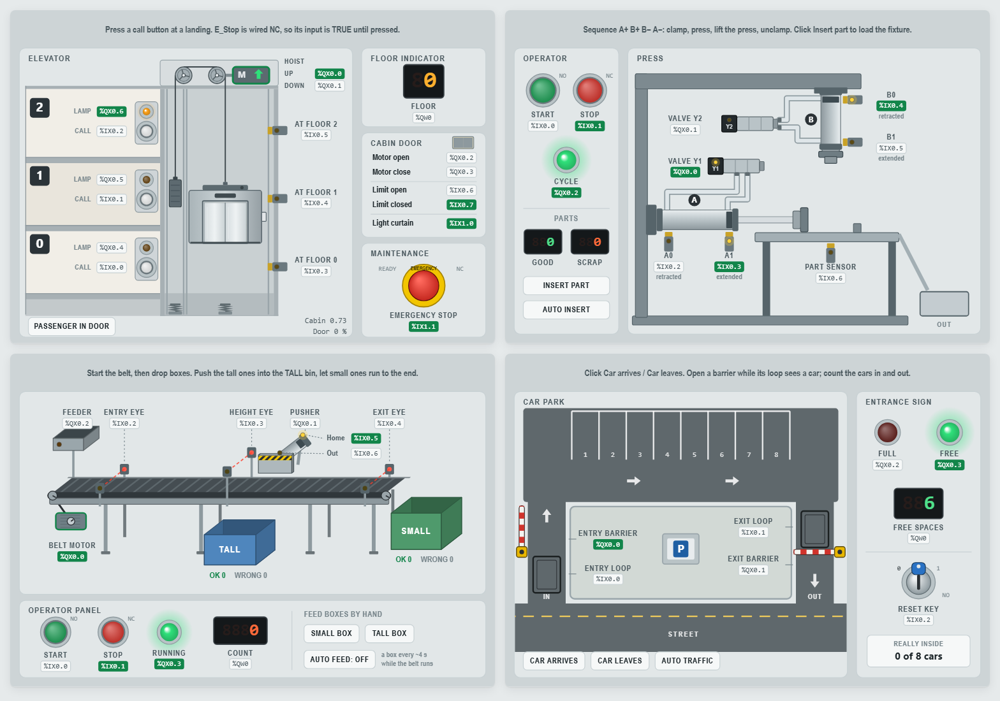
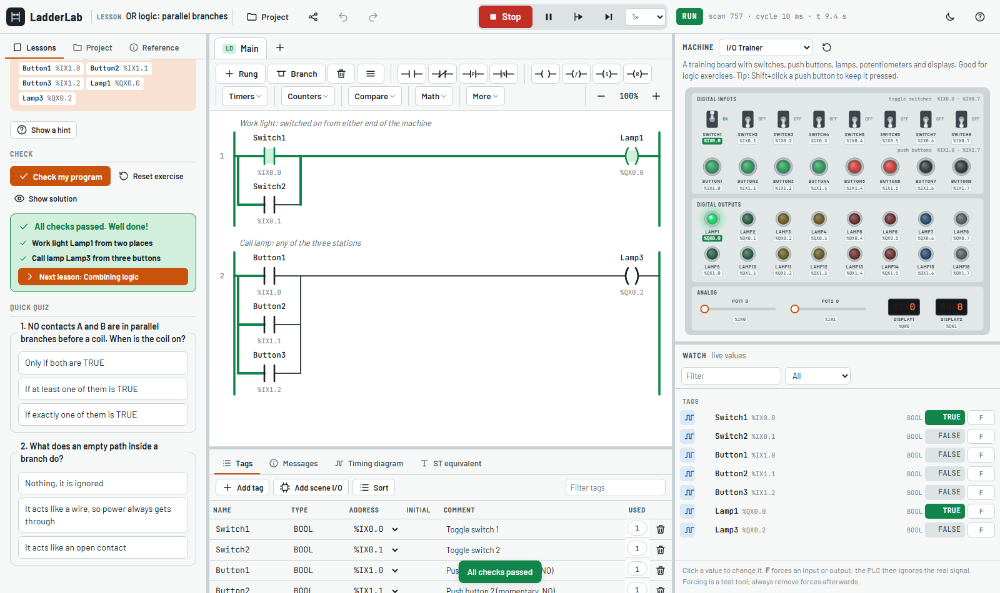

# LadderLab

**A PLC simulator for teaching ladder diagram and Structured Text (IEC 61131-3).**
Students program a simulated controller and watch it drive animated machines. A built-in course checks every exercise automatically.

**Try it:** https://mohammadrezaconstructor.github.io/ladderlab/ · **Single-file download:** [ladderlab.html](https://mohammadrezaconstructor.github.io/ladderlab/ladderlab.html)



It runs entirely in the browser, needs no installation, account or server, and works offline.

## Features

### A real scan cycle
- **I/O:** 16 digital inputs, 16 digital outputs, 4 analog inputs and 4 analog outputs, addressed `%IX0.0`, `%QX0.0`, `%IW0`, `%QW0`.
- **Scan cycle:** input image → programs top to bottom → output image, every 5–100 ms of simulated time.
- **States:** RUN, STOP and FAULT. Division by zero, an array index out of range or an endless loop (watchdog) faults the CPU and drops all outputs, as on real hardware.
- **Scan debugger:** pause, then step through one scan part by part (read inputs, each rung, write outputs). It shows the input and output terminals next to their process image, so students *see* why rung order matters and why outputs change only at the end of the scan.



### Ladder editor
- **Instructions:** NO/NC/edge contacts; normal, negated, set and reset coils; TON, TOF, TP and TONR timers; CTU, CTD and CTUD counters; R_TRIG, F_TRIG, SR, RS; compare and math boxes; parallel branches of any depth.
- **Your own function blocks:** call FUNCTION_BLOCKs you wrote in ST from a ladder rung, with pins taken from the declaration.
- **Editing:** toolbar, drag and drop, or keyboard. The properties popover autocompletes tag names and creates missing tags in one click.
- **Comfort:** undo/redo, copy/paste, rung comments, zoom for projectors, and export as PNG or SVG for worksheets.
- **Online view:** power flow in green, contact states, and live timer and counter values.
- **ST equivalent:** shows any ladder program as Structured Text. A test proves both behave identically.
- **Beginner checks:** warnings for typical mistakes, such as one output written by two coils, rungs without an output, or a timer instance used twice.

### Structured Text editor
- **Language:** assignments, IF, CASE, FOR, WHILE, REPEAT, arrays, constants, user FUNCTIONs and FUNCTION_BLOCKs, and the standard functions and conversions.
- **Live values:** the value of each variable is shown next to its line while the PLC runs.
- **Readable errors:** messages appear right on the faulty line, for example `Unknown variable "Strat". Did you mean Start?`.
- **Editing aids:** autocomplete, snippets, automatic indentation.

### Nine machines

| Machine | What students practise |
| --- | --- |
| I/O trainer | logic with switches, push buttons, 16 lamps, potentiometers, displays |
| Motor starter | seal-in, NC stop wiring, overload relay, forward/reverse with short-circuit detection |
| Traffic light | timed sequences, state machines, pedestrian requests, conflicting greens |
| Tank level | analog values, hysteresis, overflow, a mixer running dry |
| Conveyor sorting | photo-eyes, counting, pusher timing, sorting errors |
| Garage door | limit switches, light barrier, interlocks, crush detection |
| Pneumatic press | the A+ B+ B− A− sequence with reed switches |
| Parking garage | up/down counting, barriers, FULL/FREE signs |
| Elevator | a state machine with calls, doors, light curtain and emergency stop |

Every device shows its tag name and address. When a program does something unsafe, the machine explains what went wrong, for example a short circuit, a door closing on a car, or a cabin moving with its door open.



### Tools around the program
- **Watch window:** write values and force I/O.
- **Timing diagram:** a logic-analyser view with a measuring cursor.
- **Messages:** compiler errors and warnings; click one to jump to the problem.
- **Cross-reference:** where each tag is read or written.
- **Reference:** every instruction with its symbol and timing diagram, plus the ST syntax.

## The course

Each lesson has theory with diagrams, a task, graded hints, a short quiz and a **Check my program** button. The checker runs the student's program against scripted test sequences and explains each failure in plain words. Model solutions can be opened and undone.

| Chapter | Lessons |
| --- | --- |
| Ladder basics | first rung and the scan cycle, NC contacts, AND, OR, combining logic |
| Latching and edges | seal-in, set/reset, edge detection, overload and fault lamp |
| Timers | TON, TOF, TP and a blinker, a timed traffic light, TONR |
| Counters and numbers | CTU, CTUD, comparing analog values, calculating |
| Applications | forward/reverse interlock, garage door, pneumatic sequence, sorting conveyor |
| Structured Text | assignments, IF, timers and counters, CASE state machines, loops and arrays, functions and function blocks |
| Troubleshooting | find and fix the bug: programs that compile but misbehave |
| Projects | garage door, parking garage, sorting line, elevator |



## For teachers

- **Share a lesson or an exercise:** the share button in the top bar creates a link. `…/ladderlab/#lesson=ld-06-seal-in` opens a lesson. A project link opens a copy of your project in each student's sandbox.
- **Progress:** students' work and progress are saved in their browser. **Project → Copy progress report** produces a text summary they can hand in. It also notes when a model solution was viewed.
- **Handing in work:** **Project → Save project file** creates a `.json` file that you can open again with **Open project file**.
- **Classroom use:** zoom the ladder for the projector, use the scan debugger to explain the scan cycle live, and export diagrams as images for worksheets.
- **Offline:** download [ladderlab.html](https://mohammadrezaconstructor.github.io/ladderlab/ladderlab.html) (one file, about 0.9 MB) and put it on a USB stick or your LMS. The hosted version can also be installed as an app and then works without a network.

## Keyboard shortcuts

| Key | Action |
| --- | --- |
| F5 | Run / Stop |
| F10 / F11 | single scan / scan debugger step |
| Ctrl+Z / Ctrl+Y | undo / redo |
| 1–7 | ladder: insert NO, NC, coil, set, reset, TON, CTU |
| B / N | ladder: branch around the selection / new rung |
| Enter / Del | ladder: edit / delete the selection |
| Ctrl+C / X / V / D | ladder: copy, cut, paste, duplicate rung |
| Ctrl + mouse wheel | ladder: zoom |
| Shift+click | machine: keep a push button pressed |
| Ctrl+Space / Ctrl+/ | ST: autocomplete / comment lines |

## Development

Plain JavaScript with no dependencies and no build step: open `index.html` and edit. Every file attaches to the global `PLC` namespace, and the script order is defined in `index.html`.

```
js/core/      engine: data types, function blocks, ST parser and compiler, ladder model, runtime and scan debugger, grader
js/scenes/    machines: scene-kit.js (canvas toolkit and registry) plus one file per machine
js/lessons/   course content (lessons.js documents the lesson format)
js/ui/        editors, panels and the application controller
tests/        Node tests for the engine, every machine, every lesson, and script syntax
tools/        build.js (single-file build), browser-check.js (headless Chrome check), scene-preview.html
```

```
npm test                       # all tests (Node 22 or newer)
npm run build                  # dist/ladderlab.html, everything in one file
node tools/browser-check.js out [scenario.js] [--strict]   # load the app in headless Chrome, report console errors, take screenshots
```

Every push to `main` runs the tests and the browser check, then deploys the site to GitHub Pages (`.github/workflows/ci.yml`).

**Adding a lesson:** call `PLC.lessons.register({...})` in a file under `js/lessons/` and add the file to `index.html`. Ladder solutions use a compact text notation such as `[ NO(Start) | NO(Motor) ] NO(Stop) COIL(Motor)`. `npm test` checks that the solution passes the lesson's own tests, that the starter does not, and that the tag addresses match the machine.

**Adding a machine:** follow the contract at the top of `js/scenes/scene-kit.js`, using `motor.js` as a template. Preview it with `tools/scene-preview.html?scene=<id>`.

**Project files** are JSON (`"format": "ladderlab-project"`). They hold tags, programs (ladder rungs as trees, ST as source text), the machine, the scan time and the traced signals.
